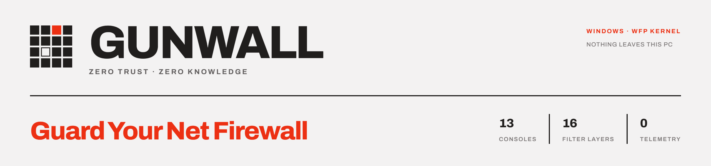
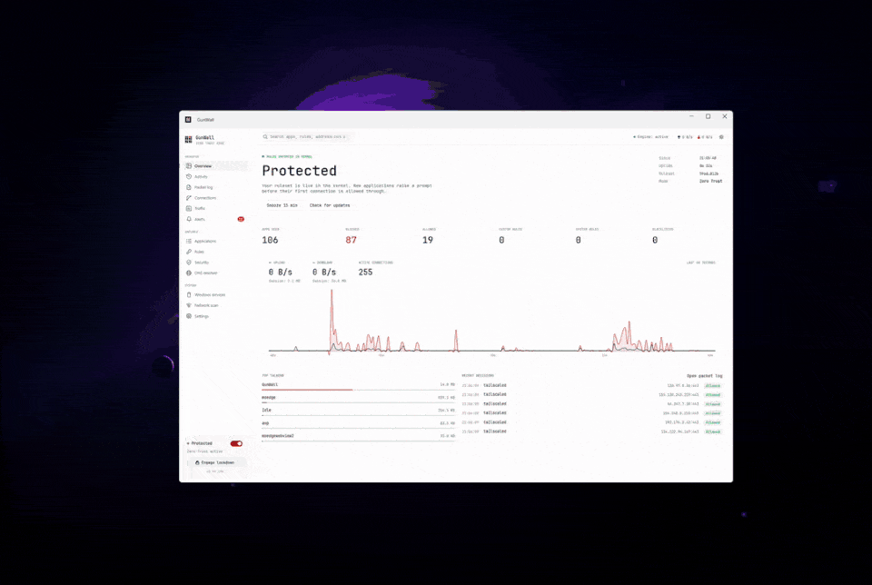
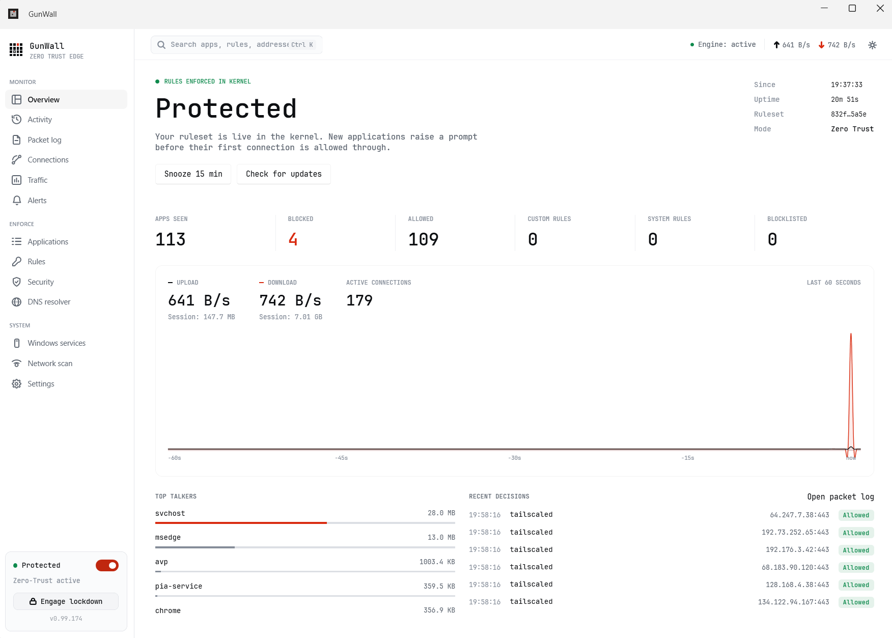
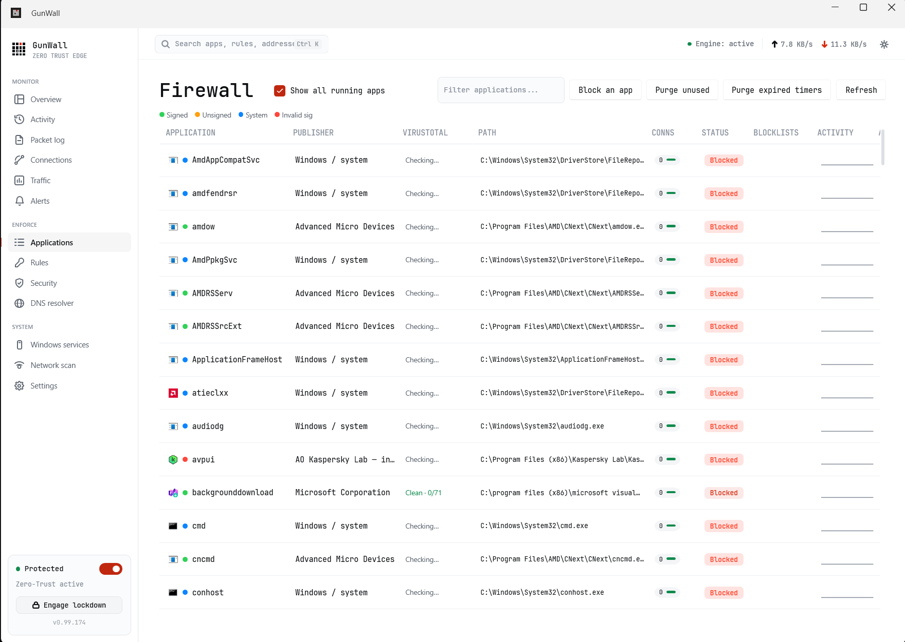
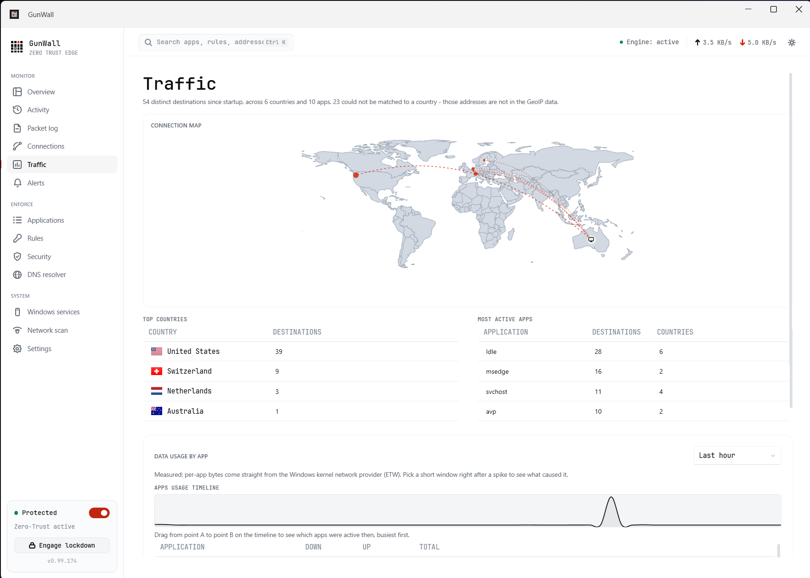
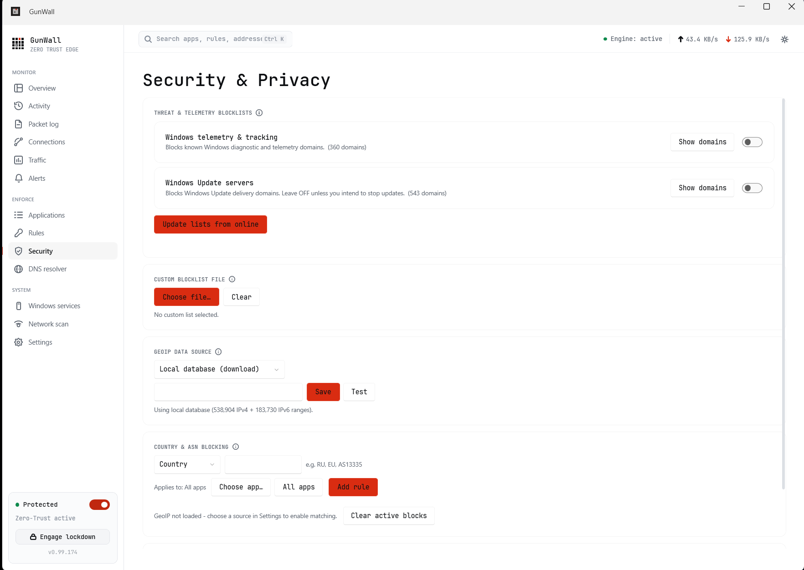
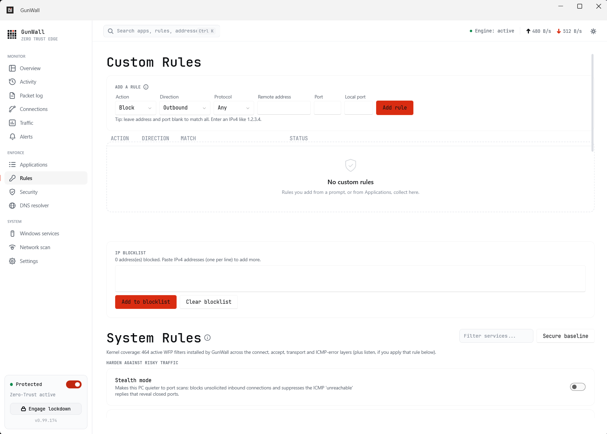
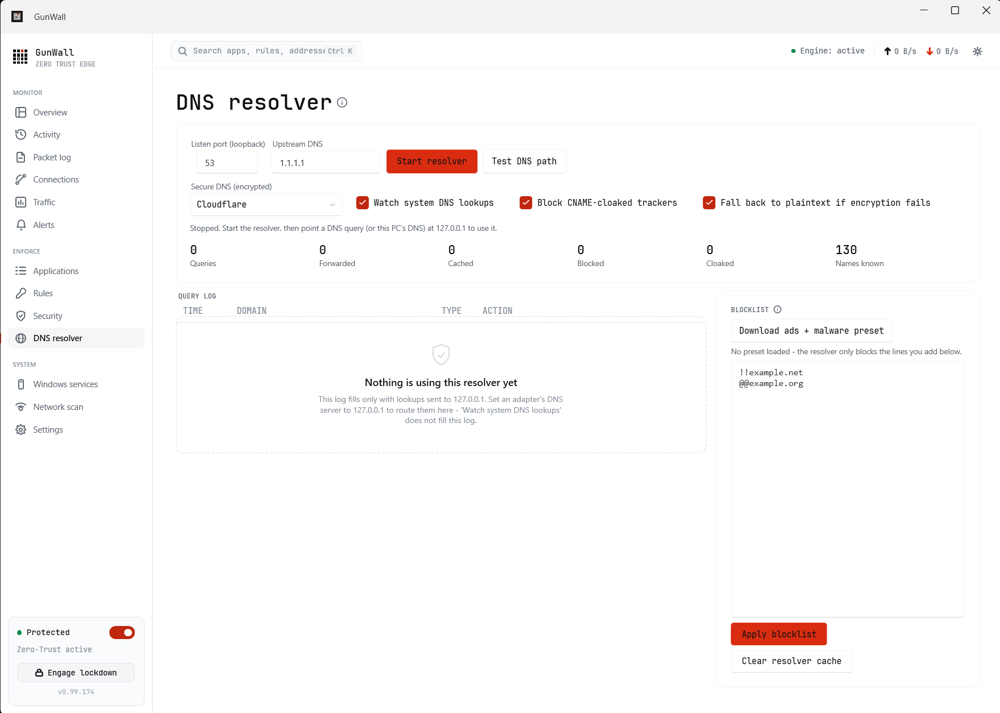
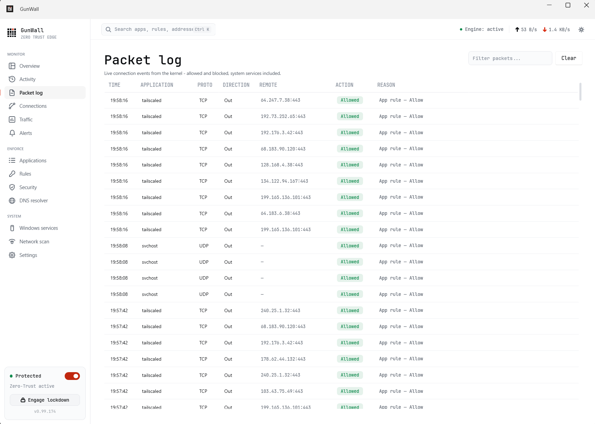

<div align="center">

<picture>
  <source media="(prefers-color-scheme: dark)" srcset="branding/png/banner-hero-dark.png">
  
</picture>

A free, open-source application firewall for Windows, built on the Windows
Filtering Platform.

[](https://github.com/ox1d3x3/gunwall/releases/latest)
[](https://github.com/ox1d3x3/gunwall/releases)
[](LICENSE)

[](https://www.microsoft.com/windows)
[](https://dotnet.microsoft.com/)
[](#privacy)
[](#project-status)

**[Download](https://github.com/ox1d3x3/gunwall/releases/latest)** ·
**[User Guide](docs/DOCUMENTATION.md)** ·
**[Report a problem](https://github.com/ox1d3x3/gunwall/issues)**

</div>

---

## About

Windows lets almost every program connect to the internet and shows you very
little of it. GunWall works the other way round: in protection mode a program is
blocked until you allow it. The first time something new tries to connect, GunWall
asks, and shows you the program, its signature, the destination, and the country
and network that destination belongs to. Your answer is kept as a rule.

It also shows what is happening on the network: live connections, data usage per
application, a map of where traffic goes, and a packet log that records why each
connection was allowed or blocked.

<div align="center">



<sub>Firefox is held back, GunWall asks, the page loads once it is allowed, and it is blocked again from <b>Applications</b>.</sub>

<br><br>

<picture>
  <source media="(prefers-color-scheme: dark)" srcset="docs/screenshots/overview-dark.png">
  
</picture>

<sub>The Overview: protection state, live throughput and the busiest applications.</sub>

</div>

### How it works

- Filtering happens in the Windows Filtering Platform, the same kernel layer
  Windows Firewall uses. There is no proxy and no driver of GunWall's own.
- In the installed version a Windows service runs the firewall, from boot and while
  the window is closed. The window opens without administrator rights and asks the
  service for every change.
- It works alongside Windows Firewall and does not touch its rules.
- Turning GunWall off, uninstalling it, or running `GunWall.exe --unblock` returns
  the machine to Windows defaults.

---

## Features

### Control

- Every application is blocked until you allow it, and the decision is saved as a rule
- Per-application rules by direction, including temporary and silent rules
- Custom rules on address, port, protocol and direction, applied in your order
- Blocking by country, continent or network operator (ASN)
- Per-service rules, so one Windows service can be stopped without affecting others in the same process
- Lockdown blocks everything at once; a pause turns protection off for a set time
- Rule profiles, for example home, work and travel
- Rules follow Microsoft Store apps and programs that install each version in a new folder
- **Protect settings**: changes that loosen protection ask for administrator approval first

### Visibility

- Live connections with process, destination, country and network operator
- Data usage per application, measured by the kernel
- A world map of destinations
- A packet log with the reason for each verdict, including blocks made by other software
- A network scanner that names devices (mDNS / Bonjour names such as *Living Room TV*, host names, manufacturer, likely operating system) and lets you add your own notes
- A traffic breakdown by application, host, protocol and country

### Privacy and DNS

- An optional local DNS resolver with encrypted DNS over HTTPS, which does not fall back to plain DNS without your permission
- Domain blocklists: Windows telemetry and update categories (individual domains can be excluded), an ads and malware preset, or your own list. `@@` allows an entry and `!!` blocks it everywhere
- CNAME cloaking protection, which follows alias chains to the real tracker
- Domain blocking per application, so blocking a tracker does not cut off other sites on the same server

### Trust

- Signature verification that tells valid, unsigned and invalid signatures apart
- Tamper detection for applications and for GunWall's own filters
- VirusTotal lookups that send only the file's hash; the API key is stored encrypted
- The profile is saved before every upgrade, with optional automatic backups
- Update checks are off by default; an update is verified before it runs and never installs itself

### Interface

- A first-run screen that offers the optional country and manufacturer databases
- Light and dark themes, including prompts, title bars and the tray menu
- UI size from 50% to 150%, also with Ctrl + mouse wheel
- Explanations behind an **ⓘ** beside each heading and option

[Every feature is explained in the User Guide.](docs/DOCUMENTATION.md)

---

## Screenshots

<sub>The pictures follow your GitHub theme (light or dark).</sub>

<table>
<tr>
<td width="50%"><picture><source media="(prefers-color-scheme: dark)" srcset="docs/screenshots/applications-dark.png"></picture></td>
<td width="50%"><picture><source media="(prefers-color-scheme: dark)" srcset="docs/screenshots/traffic-dark.png"></picture></td>
</tr>
<tr>
<td><sub><b>Applications</b>: every program with its signature and its rule.</sub></td>
<td><sub><b>Traffic</b>: destinations by country and application.</sub></td>
</tr>
<tr>
<td><picture><source media="(prefers-color-scheme: dark)" srcset="docs/screenshots/security-dark.png"></picture></td>
<td><picture><source media="(prefers-color-scheme: dark)" srcset="docs/screenshots/rules-dark.png"></picture></td>
</tr>
<tr>
<td><sub><b>Security</b>: blocklists, and blocking by country or network owner.</sub></td>
<td><sub><b>Rules</b>: custom rules, an IP blocklist and system rules.</sub></td>
</tr>
<tr>
<td><picture><source media="(prefers-color-scheme: dark)" srcset="docs/screenshots/dns-dark.png"></picture></td>
<td></td>
</tr>
<tr>
<td><sub><b>DNS resolver</b>: optional, with encrypted upstream and its own blocklist.</sub></td>
<td><sub><b>Packet log</b>: each kernel verdict and the rule behind it.</sub></td>
</tr>
</table>

---

## Compared with other firewalls

There are several good free firewalls for Windows, and one of them may suit you
better.

|  | **GunWall** | simplewall | TinyWall | Portmaster | GlassWire |
|---|---|---|---|---|---|
| Licence | MIT | GPLv3 | Open source | Open source | Proprietary |
| Cost | Free | Free | Free | Free + Pro tier | Freemium |
| Approach | Own WFP layer | Own WFP layer | Uses Windows Firewall | Own kernel layer | Uses Windows Firewall |
| Size on disk | ~190 MB | < 1 MB | ~2 MB | Moderate | Moderate |
| Country / ASN rules | Yes | No | No | Yes | No |
| Built-in DNS resolver | Yes, with DoH | No | No | Yes | No |
| Per-app domain blocking | Yes | No | No | Per-app profiles | No |
| Signed binaries | No | GPG | Yes | Yes | Yes |
| Uninstall removes filters | Yes | No, manual step | N/A | Yes | N/A |

simplewall is far smaller and has been maintained since 2016. TinyWall never shows
prompts. Portmaster also runs on Linux and is backed by a company. GlassWire's
monitoring is more polished. All four are signed; GunWall is not.

[Full comparison](docs/COMPARISON.md)

---

## Install

[Download the latest release](https://github.com/ox1d3x3/gunwall/releases/latest)

| File | Notes |
|---|---|
| `GunWall-<version>-setup.exe` | Recommended. Includes the background service, and the uninstaller removes GunWall's filters before deleting anything. |
| `GunWall.exe` | Portable. No background service; Windows asks for administrator approval each time it opens. |

1. **Run the download.** GunWall is not code-signed, so SmartScreen will warn you.
   Choose **More info → Run anyway**, or check the published SHA-256 first:

   ```
   certutil -hashfile GunWall.exe SHA256
   ```

2. **First start.** A welcome screen offers two optional databases: country and
   network owner for connections, and device manufacturers for the network scanner.
   You can skip them and download them later from **Settings → Additional data**.

3. **Turn on protection when you are ready.** GunWall starts in **Monitoring only**,
   so nothing is blocked yet. Have a look at **Connections** first, then use the
   switch in the bottom-left corner. Expect a prompt for each program that connects
   during the first few minutes.

**Requirements:** Windows 10 (2004 or later) or Windows 11, 64-bit. Installing needs
an administrator; the installed GunWall then opens without a UAC prompt.

[Full installation guide](docs/DOCUMENTATION.md#2-installing)

---

## Privacy

- No telemetry, analytics or accounts. GunWall only goes online for things you
  ask for: reverse DNS for host names, blocklist and database downloads, update
  checks if enabled, and VirusTotal lookups if you add a key. A network scan asks
  devices on your own network for their names (NetBIOS, mDNS).
- No ads.
- Nothing changes until you turn protection on, and every filter comes from a
  setting or rule you made.
- Rules and settings are plain JSON in `%ProgramData%\GunWall`. The VirusTotal key is
  the only encrypted value, so a profile can be shared safely.

---

## Project status

GunWall is in public beta and in daily use as a primary firewall. It has been
tested on a small number of machines, so your combination of Windows build, VPN
and security software may not have been tried yet. Reports are welcome.

Worth knowing:

- Filters are not kept by Windows across a reboot. In the installed version the
  background service puts them back at startup, before anyone signs in. The
  portable copy enforces nothing after a reboot until it is started again. This is
  deliberate: a reboot is always a way back to a working network.
- Other software running as administrator can remove WFP filters. GunWall detects
  this and restores them, but cannot prevent it.

[Recovery, if something goes wrong](docs/DOCUMENTATION.md#16-recovery)

---

## Roadmap

Planned: identifying WSL and other subsystem processes, verifying enforcement on
networks with routable IPv6, attributing a kernel drop to the filter that caused
it, and a multi-language interface.

Not planned: code signing. A certificate is a recurring cost; the published
checksums and the source code are the integrity check.

[Full roadmap](ROADMAP.md)

---

## Documentation

|  |  |
|---|---|
| [User Guide](docs/DOCUMENTATION.md) | Installing, configuring, every screen, troubleshooting |
| [Comparison](docs/COMPARISON.md) | GunWall next to simplewall, TinyWall, Portmaster and GlassWire |
| [Release notes](docs/RELEASE-NOTES.md) | The current release |
| [Changelog](CHANGELOG.md) | Every change in every version |
| [Architecture](docs/ARCHITECTURE.md) | How the engine works, for developers |
| [Contributing](CONTRIBUTING.md) | Building from source |
| [Security policy](SECURITY.md) | Reporting a vulnerability |

---

## Support

GunWall is free. If you find it useful and want to support it:

- [Ko-fi](https://ko-fi.com/mahabubsubhany)
- [PayPal](https://www.paypal.com/paypalme/mason7gg)

The same links are in GunWall under **Settings → About**.

---

## Contributing

Issues and pull requests are welcome. When reporting a problem, please attach a
diagnostics export (**Settings → Diagnostics → Export diagnostics**) and describe
what happened. See [CONTRIBUTING.md](CONTRIBUTING.md) before opening a pull request.

---

## License and credits

[MIT](LICENSE).

GeoIP data from the public-domain [iptoasn](https://iptoasn.com) dataset, served
via [jedisct1/iptoasn-webservice](https://github.com/jedisct1/iptoasn-webservice)
(BSD-2-Clause). Windows telemetry and update lists from
[WindowsSpyBlocker](https://github.com/crazy-max/WindowsSpyBlocker) (MIT). The DNS
resolver's ads and malware preset from
[StevenBlack/hosts](https://github.com/StevenBlack/hosts) (MIT). Device
manufacturers from the [IEEE registry](https://standards-oui.ieee.org/). Country
flags from [FlagKit](https://github.com/madebybowtie/FlagKit) (MIT). Interface
controls from [WPF-UI](https://github.com/lepoco/wpfui) (MIT).

<div align="center">

<br>


<sub>GunWall · Guard Your Net</sub>

</div>
